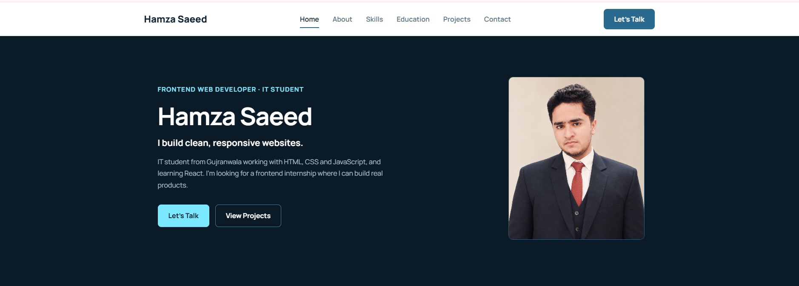
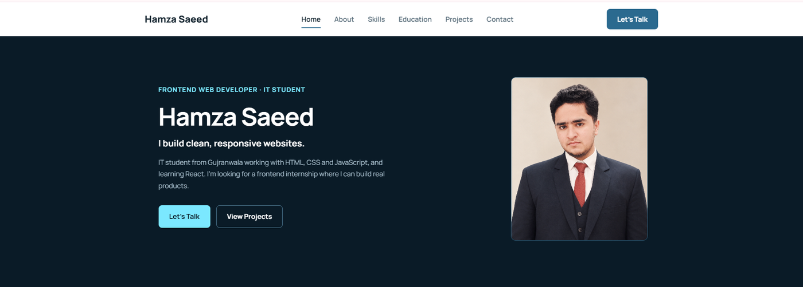
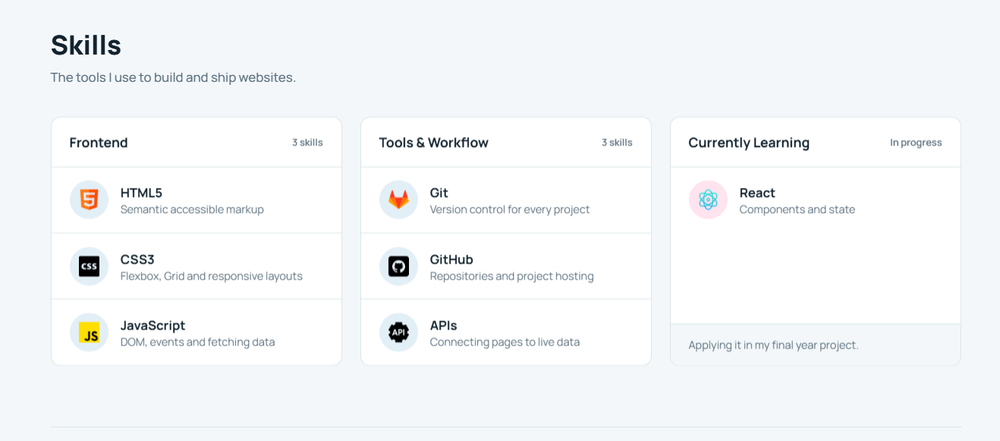
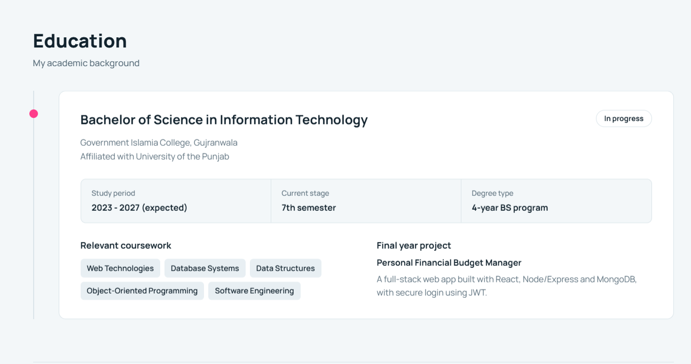
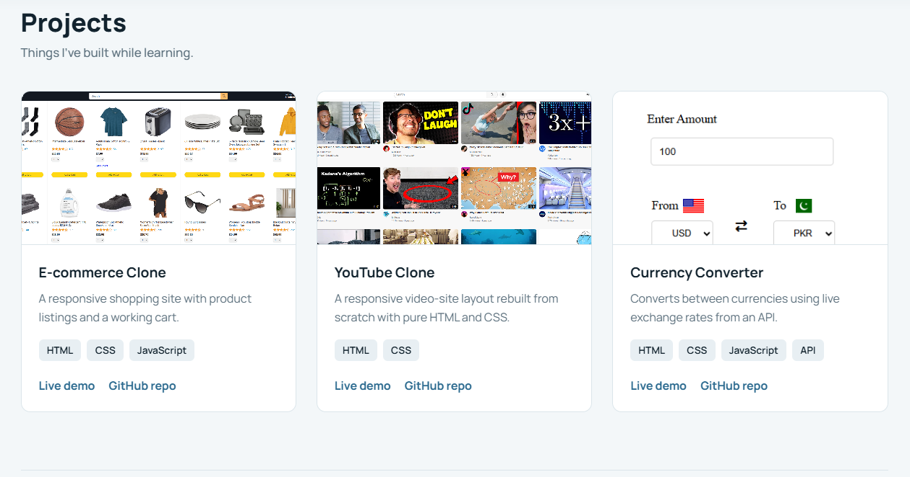
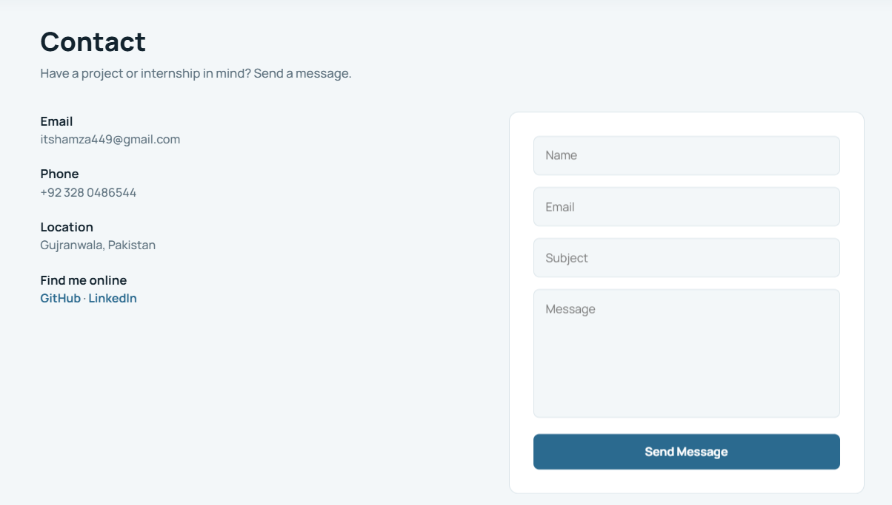
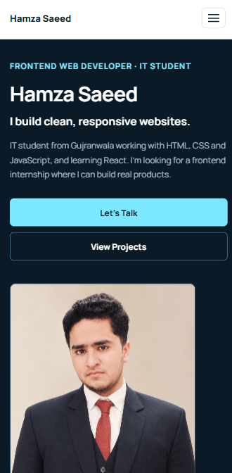
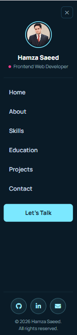

# Personal Portfolio Website

**Devixo Solutions | Web Development Internship Program | Task 01**

## Project Description

This is my personal portfolio website. I built it for Task 01 of the Devixo Solutions Web Development Internship, where the goal was to design and code a professional, fully responsive portfolio using only HTML5 and CSS3.

The site introduces me, explains my background, and shows my skills, education, projects and contact details. I designed the layout and color scheme first, then wrote all the HTML and CSS myself. I didn't use Bootstrap, Tailwind, any other CSS framework, or a downloaded template.

## Technologies Used

- **HTML5** with semantic elements (`header`, `nav`, `main`, `section`, `article`, `aside`, `footer`)
- **CSS3** (Flexbox, Grid, media queries, transitions, keyframe animations and scroll-driven animations)
- **JavaScript** (a small script that only highlights the active link in the navigation bar)
- **Google Fonts** (Manrope)
- **Font Awesome** (icon font, used only for the social icons)

## Website Features

- Fixed navigation bar with animated link underlines and a soft shadow that appears as you scroll
- Dark hero section with my name, tagline, short introduction, profile photo and call-to-action buttons
- About section with my background, career interests and a quick facts card
- Skills shown as cards, grouped into Frontend, Tools & Workflow and Currently Learning
- Education section with a timeline, study details, coursework and my final year project
- Three project cards with a screenshot, description, technologies used, live demo link and GitHub link
- Contact section with my details and a contact form (name, email, subject, message and a send button). The form is UI only and has no backend.
- Footer with my name, social links, copyright and a back-to-top link
- Responsive layout for desktop, laptop, tablet and mobile, with no horizontal scrolling
- Hamburger menu and sidebar on tablet and mobile, built with CSS only (using `:target`)
- Smooth scrolling, hover effects and scroll animations, all kept subtle
- Motion is switched off for visitors who have "reduce motion" turned on

## Project Structure

```
portfolio-website/
├── index.html
├── style.css
├── README.md
├── images/
│   ├── profile.png
│   ├── portfolio-icon.png
│   ├── html.png
│   ├── css.png
│   ├── js.png
│   ├── gitlab.png
│   ├── github.png
│   ├── api.png
│   ├── react.png
│   ├── project1.PNG
│   ├── project2.PNG
│   └── project3.PNG
├── screenshots/
└── report/
    └── Hamza_Saeed_Task01_Report.pdf
```

## Screenshots

### Desktop

| Section     | Screenshot                              |
| ----------- | --------------------------------------- |
| Home / Hero |            |
| About       |          |
| Skills      |        |
| Education   |  |
| Projects    |    |
| Contact     |      |
| Footer      |        |

### Mobile

| Page                                        | Menu open                               |
| ------------------------------------------- | --------------------------------------- |
|  |  |

## How to Run the Website

1. Download the project as a ZIP from GitHub, or clone it:
   ```
   git clone https://github.com/Code-with-Humza/portfolio-website.git
   ```
2. Open the project folder.
3. Double-click `index.html` to open it in your browser. No installation or build step is needed.
4. To check the responsive layout, resize the browser window, or press `F12` and use the device toolbar.

A few notes:

- You need an internet connection the first time, because the fonts and icons load from Google Fonts and the Font Awesome CDN.
- The scroll animations work best in Chrome and Edge. In other browsers the page still works, but the sections appear without the entrance effects.
- The sidebar menu only shows on tablet and mobile screen sizes.

## Author

**Hamza Saeed**
BS Information Technology, Government Islamia College Gujranwala (University of the Punjab)
Internship domain: Web Development
Task number: 01

- GitHub: [Code-with-Humza](https://github.com/Code-with-Humza)
